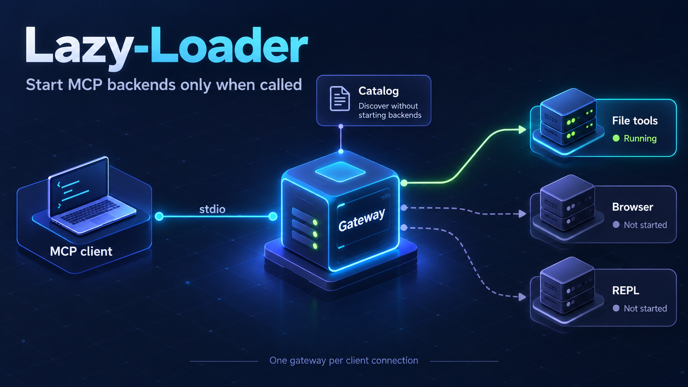
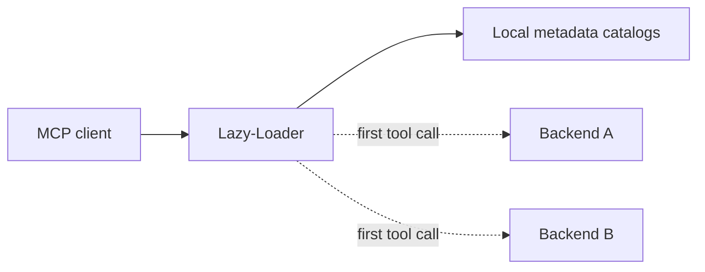
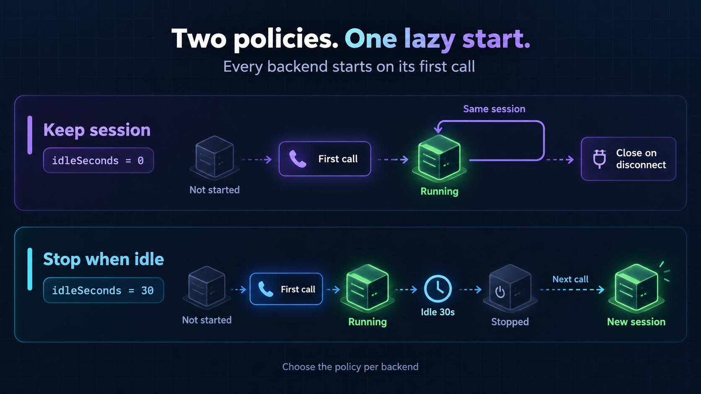

# Lazy-Loader

Start local MCP servers when their tools are called. Keep stateful sessions alive, and stop servers that can safely restart after an idle timeout.

[Thai guide](README.th.md) · [Configuration reference](docs/CONFIGURATION.md) · [MIT license](LICENSE)



Lazy-Loader is a stdio MCP gateway written with the Node.js standard library. It serves tool metadata from local catalogs, so a client can discover tools without starting every backend. No npm dependencies, network listener, background service, or changes to your MCP client's source are required.

## Requirements

- Node.js 22 or newer.
- An MCP client that can launch local stdio servers, such as Codex.
- The executables and dependencies of the backend servers you want to use. Backends are installed separately.

**Windows is the tested platform.** The gateway remains running while the client is connected. Each client connection has its own gateway and backend sessions.

## How it works



1. You explicitly create a metadata snapshot for each backend.
2. The client starts one gateway for its stdio connection.
3. Initialization and tool discovery read the catalogs without starting backends.
4. A tool call starts the matching backend and checks its live metadata.
5. Calls reuse that backend. Its idle policy determines whether it stays running.

Tools are exposed as `server__tool`, such as `files__inspect`. Tool and prompt names change when you move a server behind the gateway. Update client allowlists and approval settings accordingly.

## Tool metadata and token use

The gateway sends a short gateway-wide instruction at initialization. It adds each backend's instructions only to that backend's tool, prompt, and resource descriptions. Instructions from an unused backend no longer accompany unrelated tools. Direct tool names, schemas, and annotations remain available.

The gateway still returns every configured tool schema in `tools/list`. The MCP client decides which definitions enter the model's context. Clients with deferred tool search can load relevant definitions when needed; the gateway cannot guarantee a token saving in every client. Hiding tools from the initial list would risk making them unavailable in Codex, which [does not reliably refresh changed MCP tool lists](https://github.com/openai/codex/issues/10105).

A backend with many tools repeats its instructions in those tools' descriptions, so its `tools/list` response can grow. The smaller model-visible metadata depends on how the client presents server instructions and deferred tools.

## Choose the session policy



| Policy | Settings | Use when |
| --- | --- | --- |
| Start on demand and keep the session | `idleSeconds: 0`, `stateless: false` | The backend keeps variables, handles, logins, jobs, browser state, editor connections, or project watchers. |
| Start on demand and stop when idle | `idleSeconds: 30`, `stateless: true` | Work finishes inside each request and restarting loses no required state. |

Start with the session-preserving policy when uncertain. `stateless: true` is your assertion about the backend, not an automatic assessment. Policies apply to an entire backend, not individual tools.

An MCP response can contain a job ID while work continues in the background. The gateway cannot detect that work. Do not enable idle shutdown for live capture, background transfers, or similar sessions unless you have verified their lifecycle.

## Try it without connecting your real servers

Clone the repository and run the tests from its root. No `npm install` is needed.

```sh
git clone https://github.com/aspirin106/Lazy-Loader.git
cd Lazy-Loader
node --version
npm test
```

The tests use mock backends only. They cover lazy startup, idle restart, session retention, queueing, cancellation, protocol negotiation, catalog validation, scoped instructions, callbacks, and owned process cleanup.

Create catalogs for the two included mock servers.

```sh
node gateway.mjs snapshot examples/demo.json stateless_demo
node gateway.mjs snapshot examples/demo.json session_demo
node gateway.mjs check examples/demo.json
```

The check returns `valid: true`, `startedBackends: 0`, and two server entries containing 8 and 11 tools. The stateless demo has a two-second idle timeout. The session demo stays running after use until its connection closes.

`snapshot` deliberately starts a backend to read its metadata, then closes it. Normal gateway discovery reads the saved catalog instead. Catalogs depend on launch settings, so generated catalogs are not committed.

## Add your own backends

Use `examples/servers.template.json` as a starting point. Create your own `servers.json`, replace the placeholder paths, remove unused example entries, and create the parent directories for your catalogs.

This minimal configuration preserves a backend's session after its first call.

```json
{
	"version": 1,
	"servers": {
		"files": {
			"command": "C:/path/to/python.exe",
			"args": ["C:/path/to/server.py"],
			"inheritCwd": true,
			"catalog": "catalogs/files.json",
			"idleSeconds": 0,
			"stateless": false,
			"startupSeconds": 30,
			"timeoutSeconds": 120
		}
	}
}
```

Then create the catalog and check the complete configuration.

```sh
node gateway.mjs snapshot servers.json files
node gateway.mjs check servers.json
```

Use the actual executable. The gateway runs with `shell: false`, rejects `.cmd` and `.bat` launchers, and does not expand `%VARIABLE%` in arguments. For Node packages, use `node.exe` and the package's JavaScript entry point. For Python, use the backend's own virtual environment. Install and pin backend dependencies separately.

Use `inheritCwd: true` when a backend needs the client's project directory. Use an explicit `cwd` when it requires a fixed directory. These options cannot be combined. All configured working directories must exist, including those of backends you have not called yet.

New MCP servers are **not imported automatically**. Add each backend to the gateway configuration, choose its policy, create its catalog, and start a fresh client connection.

## Connect an MCP client

Configure your client to run this command directly over stdio.

```sh
node gateway.mjs serve servers.json
```

Use absolute paths in the client's actual configuration. Do not put a command-output filter in front of the process. Stdout is reserved for MCP JSON-RPC; gateway diagnostics go to stderr.

For Codex, the corresponding TOML entry is shown below. Replace all paths before enabling it.

```toml
[mcp_servers.lazy_gateway]
command = "C:/Program Files/nodejs/node.exe"
args = ["C:/path/to/Lazy-Loader/gateway.mjs", "serve", "C:/path/to/Lazy-Loader/servers.json"]
enabled = true
startup_timeout_sec = 10
tool_timeout_sec = 600
```

Do not set the gateway's `cwd` to its installation directory if its backends need the client's project directory. Verify the resulting directory in your actual client.

After testing, disable duplicate direct entries for the backends you moved. Preserve their original commands for rollback. Servers that need client-specific integration can stay connected directly. Moving every server is not required.

Preserve any existing per-tool restrictions. The gateway does not import `enabled_tools`, `disabled_tools`, or approval settings from your old direct entries. Do not expose a broader set of tools accidentally.

Start a new MCP connection after changing configuration. If your client has no reconnect control, close and reopen it when your running work can stop. A changed configuration does not migrate an existing session.

## Configuration and credentials

Read the [configuration reference](docs/CONFIGURATION.md) for all fields, timeouts, environment forwarding, and deferred editor discovery.

Keep real `servers.json`, catalogs, credentials, logs, and backend installations outside Git. The repository ignore rules exclude common runtime files, but inspect staged files before committing.

Use `envVars` to declare host-supplied environment names a backend needs, and configure the client to supply those variables to the gateway. For Codex, the client-side key is `env_vars`. Do not copy secret values or host registration values from someone else's machine.

Environment isolation applies to names declared in the managed `envVars` group. Other inherited variables remain available normally. This is not a sandbox for untrusted backend code.

## Commands

| Command | Behavior |
| --- | --- |
| `node gateway.mjs snapshot CONFIG.json ALIAS` | Start the named backend, discover metadata, close it, and atomically replace its catalog after successful discovery. |
| `node gateway.mjs check CONFIG.json` | Validate configuration and catalogs without starting backends. |
| `node gateway.mjs serve CONFIG.json` | Serve the gateway over stdin and stdout. |
| `npm test` | Run the mock-based test suite. |
| `npm run check` | Check the gateway's JavaScript syntax. |

A successful offline check does not prove that a backend's executable, dependencies, permissions, or external application are ready. Test a harmless real tool call through the gateway before relying on it.

## Limits and failure behavior

- This release supports stdio only. HTTP and SSE backends are not supported.
- Supported protocol versions are `2025-11-25`, `2025-06-18`, and `2024-11-05`. This does not imply support for every optional feature in those versions.
- Calls to one backend are queued. Different backends can run concurrently. Idle time starts after its active work and queued work finish.
- `idleSeconds: 0` prevents idle shutdown, not session loss from crashes, timeouts, active cancellation, or client shutdown.
- Requests are not replayed after a failure. A tool may have changed external state before its response was lost. Check the outcome before calling it again.
- On normal shutdown, the gateway closes backend stdin, waits 750 milliseconds, and uses owned process-tree termination on Windows if needed. Force-killed gateways or detached descendants can leave processes behind. This is not a Windows Job Object supervisor.
- Windows is tested. Linux and macOS process cleanup have not been validated.
- Each JSON line is limited to 16 MiB. Task-augmented tool calls are not supported.
- Prompt and resource catalog changes are not fully refreshed automatically. Resource subscription capability aggregation is incomplete. See the reference before relying on those features.
- Host-specific and experimental extensions require integration testing in your actual client.
- Backend stderr is drained rather than forwarded, to avoid copying sensitive backend diagnostics into client logs. Diagnose backend startup separately when needed.

Version 0.2.1 fixes a false `MCP catalog changed` error when the snapshot and client negotiate different supported protocol versions. Real schema, server identity, and instruction drift checks remain enabled.

## Troubleshooting

| Symptom | Check |
| --- | --- |
| `missing or invalid catalog` | Create the catalog, confirm its path, and check JSON validity. |
| `catalog does not match launch settings` | Snapshot again after changing command, arguments, fixed working directory, literal environment, or managed environment names. |
| `MCP catalog changed` | On 0.2.1, compare live metadata with the catalog. Review the backend update before refreshing it. |
| `Tool schema changed` | Refresh the client tool list before calling a changed dynamic tool. |
| Backend starts in the wrong project | Check inherited working directories and the client-side gateway `cwd`. |
| Python or Node processes remain | Identify the gateway and backend PIDs. Session-preserving backends and separate client connections are expected to retain processes. |
| Duplicate direct and gateway processes | Disable the moved direct entry and end the old client connection. |
| Only a `connect` tool appears | A deferred backend still needs its external application or live discovery. |
| Process-tree test fails in a sandbox | Check whether the environment permits terminating owned child processes. Do not disable lifecycle checks to hide a permission failure. |

## License

[MIT](LICENSE). Backend programs retain their own dependencies and licenses; they are not included in this repository.
